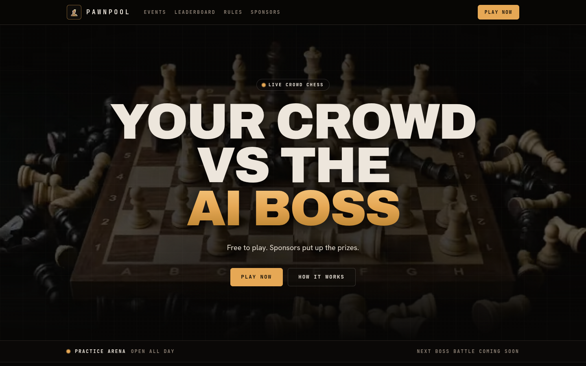
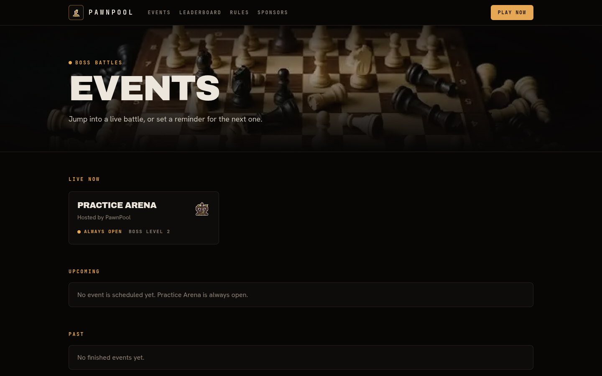

# PawnPool

Your community plays chess together against an AI Boss. Free to play, sponsors put up the prizes.

Live at https://pawnpool.rahmateka.my.id



## How a Boss Battle works

Every turn the arena shows three candidate moves for the crowd. You have 15 seconds to pick one. When the timer ends, the move with the most picks is played on the board, and then the Boss replies. This goes on until the Boss is checkmated, the crowd runs out of moves, or the game is drawn.

You earn points for every turn you pick. Showing up gives 10 points. On top of that you get `round(100 * max(0, 1 - cpLoss / 300))`, where `cpLoss` is how many centipawns worse your pick was than the best candidate. So the best move is worth 110 points and a blunder is worth close to 10. After each turn the quality of all three candidates is revealed, so you can see what you should have picked.

If you picked in at least 5 turns you get an end-of-event bonus. It is 500 points when the crowd checkmates the Boss, and 200 when the crowd survives to the move limit or draws. To be eligible for the prizes of an event you need to have picked in at least 10 turns. Points count on a per-event leaderboard and on a monthly season leaderboard. Practice rooms never have prizes.

The events page lists the battle that is live now, the next ones and the finished ones. The practice arena is always open.



## Why it is free

There is no betting in PawnPool. Playing is free and you never put money in. Sponsors and creators are the ones who pay, so the prizes come from them.

## How it makes money

Sponsors pay to run a named event with their logo, their prize text and a report afterwards. Later I want to add a Creator Pro plan for people who run events for their own community, and cosmetics for players. Playing stays free.

## Tech

It is a Next.js app with Postgres through Prisma, a Stockfish WASM engine for the Boss and the candidate moves, and wallet sign-in with SIWE.

## Run it locally

You need Node 22, pnpm 9 and Docker.

1. Start a Postgres database:

   ```bash
   docker run -d --name pp-dev -e POSTGRES_PASSWORD=pp -p 5544:5432 postgres:17-alpine
   ```

2. Install and set up the env file:

   ```bash
   pnpm install
   cp apps/web/.env.example apps/web/.env
   ```

   In `apps/web/.env` set `DATABASE_URL` and `DIRECT_URL` to `postgresql://postgres:pp@localhost:5544/postgres` (a local database needs no pooler flags), and `SESSION_SECRET` to a random string of at least 32 characters.

3. Apply the migrations and seed the practice room:

   ```bash
   pnpm --filter web exec prisma migrate deploy
   pnpm --filter web db:seed
   ```

4. Start the app and open http://localhost:3000:

   ```bash
   pnpm --filter web dev
   ```

Tests:

```bash
pnpm --filter web lint
pnpm --filter web typecheck
pnpm --filter web test
pnpm --filter web test:int
```

The integration tests use the database in `TEST_DATABASE_URL`, which defaults to the Docker database above. After a build you can check a running copy with `pnpm smoke http://localhost:3000`.

## Deploy

The site runs on Vercel with a Neon Postgres database. In the Vercel project set the Root Directory to `apps/web`, which reads `apps/web/vercel.json`. Add the variables from `apps/web/.env.example` (database URLs, `SESSION_SECRET`, `ADMIN_ADDRESSES`, `CRON_SECRET`, and optionally the WalletConnect id and site URL). On Neon, `DATABASE_URL` is the pooled URL and must end with `?pgbouncer=true&connect_timeout=15` (or `&pgbouncer=true&connect_timeout=15` when it already has a query string). `DIRECT_URL` is the non-pooled URL and is required in every environment, because the build runs `prisma migrate deploy` whenever `DATABASE_URL` is set and fails without it. `vercel.json` pins the functions to `sin1` to sit next to the Singapore database. After the first deploy, seed the practice room once with `pnpm --filter web db:seed`. A daily cron calls `/api/cron`.

## Stockfish

The engine is Stockfish 19 lite, vendored in `apps/web/vendor/stockfish` together with its GPL-3.0 license.

## License

The PawnPool code is released under the [MIT License](LICENSE).
